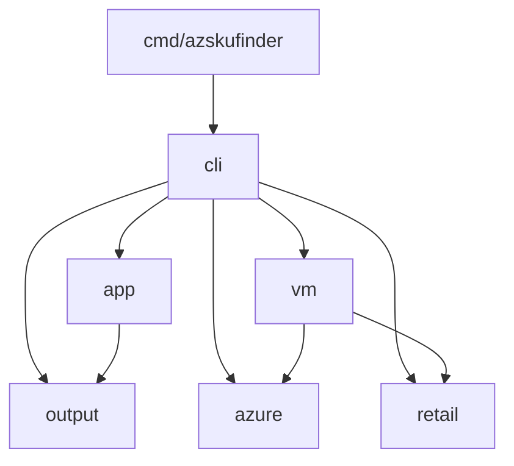

# Architecture

This is how azskufinder's Go code is laid out, how the pieces are wired
together, and why. Read it before you change the code, whether you're a person
or an agent. Setting up, the checks a change must pass and how releases work are
in [CONTRIBUTING.md](CONTRIBUTING.md).

## Contents

- [Overview](#overview)
- [Layout](#layout)
- [Dependency rules](#dependency-rules)
- [Wiring and dependency injection](#wiring-and-dependency-injection)
- [Design principles](#design-principles)
- [Cross-cutting concerns](#cross-cutting-concerns)
- [Testing](#testing)
- [Recipes](#recipes)
- [Tooling](#tooling)

## Overview

azskufinder is one binary with one command so far, `vm`. A run reads settings,
asks Azure for three things at once (the VM SKUs offered in a location, the
subscription's compute quota there, and retail prices), narrows the SKUs down to
the ones the subscription can deploy, sorts and limits them, then prints a table
or JSON. With `--include-spot` it also reads Spot eviction rates.

```text
cmd/azskufinder/main.go       signal context, build version
        │
        ▼
cli.Execute                   builds App and the cobra tree, prints any error, picks the exit code
        │
        ▼
PersistentPreRunE             viper: flags > env > config file > defaults; --debug; colour per stream
        │
        ▼
runVM (cli/vm.go)             readVMOptions → validated vm.Filter        ← every usage error is raised here
        │                     builds credential, clients and the service  ← the composition root
        ▼
vm.Service.Find               ┌─ armSource.listSKUs   ─┐
                              ├─ armSource.listQuota  ─┤  errgroup, at the same time
                              └─ priceSource.Query    ─┘
                              assess → rank → eviction rates (Spot only)
        │                     returns vm.Result: plain data plus warnings
        ▼
writeVMResult (cli/vm_output.go)   table via output.Table, or JSON via output.JSON, on stdout
printWarnings                      on stderr
```

## Layout

```text
cmd/azskufinder/
  main.go           entry point: signal.NotifyContext, buildVersion, os.Exit(cli.Execute(...))
internal/
  app/              App: the long-lived dependencies shared by every command
  azure/            Azure SDK plumbing shared by every client; no resource types
    azure.go          NewCredential (cached, errors wrap ErrSignIn), ClientOptions, ErrorText, EnableSDKLogging
    validate.go       ValidSubscriptionID, ValidLocation, ValidSKUName: guards for URLs, OData and Kusto
  retail/           client for the Azure Retail Prices API on an azcore pipeline; no resource types
  output/           rendering for people (table) and scripts (JSON); no resource types
    output.go         Formats, ParseFormat
    table.go          Table[T] and Column[T]
    json.go           JSON
    format.go         Money, Zones, NoValue
    style.go          Styles (colour on or off, as a value), Sanitise
    spinner.go        Spinner
  vm/               everything VM-specific; returns plain data
    vm.go             result types: VM, Result, Summary, Warning and the warning codes
    service.go        Service.Find, and the armSource and priceSource interfaces it consumes
    arm.go            ARMSource: the ARM adapter (Resource SKUs, Usages, Resource Graph)
    filter.go         Filter and its Parse* functions, then the filtering: assess, candidates, applyQuota, rank
    pricing.go        priceFilter, indexPrices, applyPrices
    sort.go           Sort, ParseSort and the table of sortable columns
  cli/              the cobra commands and the composition root
    root.go           Execute, exit codes, newRoot and the global flags
    vm.go             newVMCmd, readVMOptions, runVM
    vm_output.go      the vm table's columns, headline and footer, and the JSON document
    options.go        commonOptions and the strict readers (readBool, readOptionalInt, ...)
    viper.go          setupViper, config file, completion and env-name helpers
    defaults.go       defaults, accepted currencies, the config path
    errors.go         usageError, withHint, hintFor, printError
    colour.go         setStyles, colourFor
    spinner.go        spinnerOn
    timeout.go        withTimeout
    helpers.go        isTerminal
```

Everything is under `internal/`: azskufinder is a CLI, not a library, so no
package makes a promise to outside importers. The only stable interfaces are the
command line and the JSON output.

## Dependency rules

The packages form layers, and imports only point down. There is no linter
enforcing this (depguard was dropped in favour of this section), so keep to it
in review.



Each arrow is one import. `cli` imports `output`, `azure` and `retail` directly:
`output` for styles, rendering and sanitising; `azure` for the credential,
client options, SDK logging, input checks, error text and `ErrSignIn`; and
`retail` to build the price client it hands to `vm`.

| Package | May import | Must not import |
|---|---|---|
| `cmd/azskufinder` | `cli` | anything else in `internal` |
| `cli` | every `internal` package, cobra, viper, azcore (to read `*azcore.ResponseError`) | `cmd` |
| `app` | `output`, viper | `cli`, any resource package, `azure`, `retail` |
| `vm` | `azure`, `retail`, the ARM SDK packages, errgroup | `cli`, `app`, `output`, cobra, viper |
| `azure` | azcore, azidentity | any other `internal` package |
| `retail` | azcore `policy` and `runtime` | any other `internal` package |
| `output` | go-pretty | any other `internal` package, the Azure SDK |

Some rules within packages too:

- **Only `cli` knows about cobra and viper.** Domain packages take plain values
  (`vm.Filter`, a location string), so they can be used and tested without a
  command line.
- **Only `vm.ARMSource` touches ARM SDK model types.** It converts them to the
  package's own `sku` and `quota` structs straight away (`convertSKU`, `deref`),
  so the filtering never sees an SDK pointer.
- **`azure`, `retail` and `output` know nothing about any resource type.** A
  second resource command must not need changes there. If it seems to, the code
  probably belongs in the resource package or in `cli`.
- **Resource packages know nothing about presentation.** The table columns for
  VMs (`vmColumns`) live in `cli/vm_output.go`, not in `vm` or `output`, because
  styles, currency and Spot are CLI choices.

Third-party libraries, and what each is for:

| Library | Used for | Used in |
|---|---|---|
| `azure-sdk-for-go/sdk/azcore`, `azidentity` | pipeline, retries, credentials, logging | `azure`, `retail`, `vm`, `cli` |
| `armcompute/v7`, `armresourcegraph` | Resource SKUs, Usages, Resource Graph | `vm` (`arm.go` only) |
| `spf13/cobra`, `spf13/viper` | commands, flags, env and config file | `cli`; `app` holds the `*viper.Viper` |
| `jedib0t/go-pretty/v6` | table layout and ANSI colour | `output` |
| `golang.org/x/sync/errgroup` | concurrent fetches | `vm` |
| `google/go-cmp` | test diffs | tests only |

Add a dependency only when the standard library can't reasonably do the job,
and say why in the pull request.

## Wiring and dependency injection

There is no DI framework or container. Dependencies are passed to constructors,
and they're all wired up in one place.

### The composition root

`cli` is the composition root. `runVM` in `cli/vm.go` builds everything a run
needs, in this order:

1. `readVMOptions` reads and validates every setting into `vmOptions` (the
   shared `commonOptions` plus a `vm.Filter`).
2. `withTimeout` bounds the run with `--timeout`.
3. `azure.EnableSDKLogging`, then `azure.NewCredential`. The one credential is
   shared by every client, so `az login` and the like run once per run.
4. `azure.ClientOptions(version)`: the user agent, retries and log settings
   every client shares.
5. `vm.NewARMSource(subscriptionID, cred, clientOpts, logger)` and
   `retail.NewClient(currency, clientOpts, logger)`.
6. `vm.NewService(src, prices, logger)`.
7. `svc.Find(ctx, location, filter)`, then `writeVMResult` and `printWarnings`.

### What lives on `App`, and what doesn't

`app.App` holds only what exists before the flags are parsed and lasts for the
whole process: the version, the logger and its `LevelVar`, the `*viper.Viper`,
and the `Styles` for stdout and stderr. `Execute` creates it and passes it to
each `newXxxCmd`.

API clients and services are deliberately **not** on `App`. They depend on
parsed settings (subscription, currency), so they're built in `RunE`. Don't add
a client to `App` to share it between commands. Build it in the command that
needs it.

### Interfaces belong to the consumer

The module has exactly two interfaces, both unexported and in
`vm/service.go`:

```go
type armSource interface {
	listSKUs(ctx context.Context, location string) ([]sku, error)
	listQuota(ctx context.Context, location string) (map[string]quota, error)
	listEvictionRates(ctx context.Context, location string, skus []string) (map[string]string, error)
}

type priceSource interface {
	Query(ctx context.Context, filter string) ([]retail.Price, error)
}
```

`Service` declares what it needs, and the concrete types (`*vm.ARMSource` and
`*retail.Client`) satisfy it without knowing. The rules that follow from this:

- **Constructors return concrete types** (`*ARMSource`, `*retail.Client`,
  `*Service`), not interfaces.
- **Declare an interface in the package that uses it**, with only the methods it
  calls. Don't declare one next to its implementation "for mocking".
- **Don't add an interface with one implementation and no test that needs it.**
  These two exist because `Service.Find` is tested with hand-written fakes.
- `armSource` has unexported methods because its implementation is in the same
  package, which keeps the adapter's surface private. `priceSource.Query` is
  exported because `retail.Client` is in another package.

### Smaller injection conventions

- **A nil `*slog.Logger` means discard.** Every constructor that takes a logger
  swaps nil for `slog.New(slog.DiscardHandler)` and tags its own with
  `log.With("component", "<name>")`. Tests pass nil unless they check the log.
- **The environment is a parameter.** Functions that read environment variables
  take `getenv func(string) string` (`colourFor`, `spinnerOn`), and `runVM`
  passes `os.Getenv`. The one exception is viper's `AutomaticEnv` (see
  [Testing](#parallel-by-default-always-with--race)).
- **Writers are parameters.** Output goes to `cmd.OutOrStdout()` and
  `cmd.ErrOrStderr()`, never straight to `os.Stdout`, so tests can capture it.
- **No package-level mutable state.** Styles are an `output.Styles` value passed
  in, not a global. The only process-wide side effect is
  `azure.EnableSDKLogging`, because azcore has no per-client logger.
- **Endpoints and timings are fields.** For example `retail.Client.endpoint`, so
  tests point it at an `httptest.Server`, and `retail.NewClient` keeps a
  `Retry.MaxRetryDelay` set by the caller, so tests can make retries fast.

## Design principles

### SOLID, as it applies here

- **Single responsibility.** Each package has one job, and in `vm` each file
  does too: types (`vm.go`), orchestration (`service.go`), the ARM adapter
  (`arm.go`), filtering (`filter.go`), prices (`pricing.go`), ordering
  (`sort.go`). `Service.Find` coordinates and leaves the logic to small pure
  functions (`candidates`, `applyQuota`, `applyPrices`, `rank`).
- **Open/closed.** `output.Table[T]` renders any row type from a list of
  `Column[T]`, so a new resource type adds columns without touching `output`.
  Sorting is table-driven: a new sort column is one entry in `sortColumns`, and
  `ParseSort`, `SortKeyNames`, help text and completion pick it up.
- **Liskov substitution.** A fake `armSource` or `priceSource` in a test is a
  drop-in for the real one, because the interface states the contract in plain
  types (`sku`, `quota`, `retail.Price`), not SDK types.
- **Interface segregation.** The interfaces hold only the methods `Service`
  calls: three for ARM and one for prices.
- **Dependency inversion.** `Service` depends on the interfaces it declares, not
  on the SDK. Concrete clients are chosen once, in `cli`.

### House rules

- **Keep the logic unexported.** The logic most worth testing, such as `assess`
  and `rank`, is unexported. Tests sit in the same package to reach it. Never
  export something only for a test.
- **Domain packages return plain data.** `vm.Result` is structs, slices and
  pointers, with JSON tags. Words, colour and layout are the caller's job.
- **Unknown is nil, never zero.** A missing price is a nil `*float64`, so it
  can't look free. Sorting puts missing values last in either direction.
- **Required data fails the run; optional data becomes a warning.** SKUs and
  quota are required, so their errors cancel the other fetches and fail
  `Find`. Prices and eviction rates only improve the answer, so their failure is
  a `vm.Warning` with a stable `Code` (`WarningPricingUnavailable`,
  `WarningSpotUnavailable`, `WarningQuotaMissing`). A cancelled or timed-out
  context always fails the run, and never turns into a warning.
- **Validate at the edge, and check invariants in the domain too.**
  `readVMOptions` and `readCommon` report everything a person can get wrong
  before any request, as usage errors with hints. The domain still checks what
  it relies on: `Service.Find` checks the location before it goes into an OData
  filter and a Kusto query, and rejects a Spot sort without `IncludeSpot`;
  `NewARMSource` checks the subscription ID.
- **Don't guess.** A SKU whose capabilities can't be parsed is skipped and
  logged (`parseVM`), and so is a missing quota entry, with a warning, rather
  than assumed to fit.
- **Comments say why.** Doc comments on every exported identifier, and comments
  inside functions only where the reason isn't obvious from the code.

## Cross-cutting concerns

### Configuration

`setupViper` (`cli/viper.go`) runs in the root's `PersistentPreRunE` and binds,
highest precedence first: flags, then `AZSKUFINDER_*` environment variables
(the flag name in upper case, hyphens as underscores), then
`~/.azskufinder/config.yaml` or the file named by `--config`, then the flag
defaults in `cli/defaults.go`. A missing default config file is fine; a
`--config` file that doesn't exist, or any file that can't be parsed, is a
usage error.

Values are read with the strict readers in `cli/options.go`, not viper's
`Get*`, because viper turns bad values into zero without complaining:

- `readBool`: `"yes"` is an error, not false.
- `readOptionalInt` and `readOptionalFloat` return nil when the value wasn't
  given anywhere, which is how `--gpus 0` differs from no `--gpus`.
- `readDuration`: a bare number is an error, not nanoseconds.

Every flag's help text ends with its environment variable, added by `usage()`.
Flags with fixed values offer them for shell completion with `registerFixed`.

### Errors, hints and exit codes

- Commands return errors unchanged. `cli.Execute` is the only place they're
  printed: `error: <message>` in red on stderr, then an optional `hint: <what to
  do>` (`printError`).
- Messages say what went wrong; hints say what to do about it. Attach a hint
  with `withHint`, or teach `hintFor` (`cli/errors.go`) to recognise a known
  failure, such as `azure.ErrSignIn`, a 401 or 403, or an unknown location.
- `usageErrorf` marks a mistake in how the command was used, and so does any
  flag or argument cobra can't parse (`flagUsageError`, `usageArgs`).
- `exitCode` maps the outcome: `0` success (including no results), `1` a run
  time failure, `2` a usage error, `130` interrupted.
- Wrap errors with `%w` and a short lower-case context (`"listing resource SKUs:
  %w"`), so `errors.Is` and `errors.As` keep working. Sentinels are
  `ErrXxx` variables (`azure.ErrSignIn`, `retail.ErrThrottled`).
- `azure.ErrorText` cuts the SDK's multi-line response error down to the
  service's message, code and status. The full response is still in the debug
  log.

### Streams, colour and the spinner

- **Results go on stdout, and nothing else does.** The spinner, warnings, debug
  logs and errors go to stderr, so `-o json | jq` always works.
- Colour is decided separately for each stream (`setStyles`, `colourFor`): off
  with `--no-colour`, when the stream isn't a terminal, when `NO_COLOR` is set,
  or when `TERM=dumb`. It's decided once before the flags are parsed, so a flag
  parse error is styled correctly, and again once `--no-colour` can be read.
- The spinner shows only on a terminal, without `--debug` and with a
  `TERM` other than `dumb` (`spinnerOn`). It's stopped before anything is
  written, and a nil `*output.Spinner` is safe to `Stop`.

### Logging

`log/slog`, text to stderr, at info level until `--debug` lowers it to debug.
The code only logs at debug level: anything a person must see is a warning or
an error. Every logger carries a `component` attribute (`cli`, `vm`, `vm.arm`,
`retail`, `azure-sdk`). Log keys are `snake_case`, attributes are plain
key-value pairs, and nothing uses slog's global logger (sloglint checks the
last two). Log the
reason each SKU was left out (`"reason", "no-quota"`), the counts and the
durations: `--debug` is how people find out why a SKU is missing.
`azure.EnableSDKLogging` adds the SDK's request, response and retry events.

### Timeouts and cancellation

`main` cancels the context on Ctrl+C or SIGTERM, and `withTimeout` adds
`--timeout`. Every call that might block takes the context. The SDK retries
throttled requests itself (three times, honouring `Retry-After`), except that
the Retail Prices client caps the wait (`maxRetryDelay`) and returns
`ErrThrottled` instead of waiting a minute. Loops over pages that follow a
server-supplied link stop on a repeated link, and the hand-written Resource
Graph loop also has a page cap (`spotMaxPages`).

### Untrusted input and output

- **Anything put into a URL, OData filter or Kusto query is checked first** with
  the guards in `azure/validate.go`. OData string literals are built with
  `retail.Quote`. SKU names that fail `ValidSKUName` are left out of the eviction
  query, rather than failing it for every SKU.
- **Text from Azure is sanitised before it reaches a terminal**, so it can't
  move the cursor or rewrite the title: `output.Sanitise` for warnings and
  errors, and `output.Table` sanitises every cell itself. JSON doesn't need it,
  because the encoder escapes control characters.
- **Credentials are never flags.** Sign-in is the SDK's default credential chain
  only.

### JSON output is a contract

`-o json` writes `vmDocument` (`cli/vm_output.go`): `apiVersion`, `kind`,
`criteria` and `pricing`, with `vm.Result` embedded so its fields sit at the top
level. Within one `jsonAPIVersion` (`azskufinder/v1`), fields may only be
added. Renaming, removing or retyping one means a new version.
`TestVMDocument_schema` enforces this against
`cli/testdata/schema_azskufinder_v1.txt`: `-update` records new fields, but it
can't paper over a removed or changed one. Slices in the output are never nil,
so scripts see `[]`, not `null`.

## Testing

The commands you need:

| Command | What it does |
|---|---|
| `make test` | every test with `-race`, in random order (`-shuffle=on`), uncached |
| `make test-short` | the same, using the test cache |
| `make golden-update` | rewrites golden files (`go test ./internal/output ./internal/cli -update`) |
| `make fuzz` | runs each fuzz target for `FUZZTIME` (30s by default) |
| `make cover` / `make cover-html` | coverage by function, or in a browser |

### Tools and style

- **Standard library plus `go-cmp`, no assertion framework.** Check with plain
  `if`, using `t.Errorf` to carry on and `t.Fatalf` only when the test cannot
  continue. Compare structs and slices with `cmp.Diff(want, got)`, which shows
  the path to the field that differs, rather than `reflect.DeepEqual`, which
  only says that something did. Messages read `Func(input) = got, want want`, or
  `Func() mismatch (-want +got):\n%s` for a diff. Not testify or Gomega: Go's
  review guidelines discourage assertion libraries.
- **Table-driven tests by default.** A slice of `struct{ name string; ... }`
  cases, each run with `t.Run(tc.name, ...)`, so a case fails and runs on its
  own (`go test -run 'TestAssess/zone restricted'`). A slice rather than a map
  keeps the order stable. When cases need different setup or different checks,
  write separate test functions instead of adding `setup func` or `wantErr`
  fields until the table is harder to read than the code.
- **Current `testing` helpers.** `t.Helper()` as the first line of any helper
  that can fail a test, so the failure is reported at the caller's line.
  `t.Context()` rather than `context.Background()`, plus `t.Cleanup` and
  `t.TempDir`. Use `testing/synctest` for anything timed or concurrent (the
  spinner in `output`, `--timeout`, `errgroup` cancellation) rather than real
  sleeps. Pass a nil logger unless the test checks log output, and then use a
  `slog.NewTextHandler` over a `bytes.Buffer`.

### Where tests sit, and what they test

- **Tests sit in the package they test** (`package vm`, not `vm_test`), because
  the logic most worth testing, such as `assess` and `rank`, is deliberately
  unexported. Never export something only for a test.
- **Test at the smallest stable seam.** Test pure functions directly,
  `Service.Find` with fakes, adapters with the SDK fakes, and the cli's option
  readers and output builders directly. `RunE` builds real Azure clients, so it
  is not unit-tested; drive the command tree from `newRoot` with
  `SetArgs`/`SetOut`/`SetErr` (`newTestRoot` in `cli/helpers_test.go`), only on
  paths that fail before a client is built. `Execute` itself is not unit-tested.
  Do not test trivial getters, the SDK or go-pretty.
- **Hand-written fakes, no generated mocks.** A fake for a consumer interface
  (`armSource`, `priceSource`) is a small struct in the test file that returns
  canned data or errors, and records calls only when a test needs them. Fakes
  test what the code returns; generated mocks (gomock, mockery) tend to test the
  order of calls, and break on refactors.
- **HTTP goes through the real azcore pipeline.** `retail` is tested against an
  `httptest.Server`. The ARM adapter is tested with the SDK's generated fake
  servers (`armcompute/v7/fake`, `armresourcegraph/fake`) set as
  `ClientOptions.Transport`, with `azfake.TokenCredential`, so the conversion
  from SDK types is tested against real SDK types. Set retry delays short in
  tests, so retries do not slow them down. Unit tests never call Azure.

### Golden files and the JSON schema

- **Golden files only for multi-line rendered output.**
  `testdata/<name>.golden`, rewritten with a package `-update` flag
  (`make golden-update`), for `output.Table`, `output.JSON` and
  `writeVMResult`. Short strings, such as the headline, `Money` or
  `describeFilter`, are checked inline, where the expected value can be read.
  Review the diff of a rewritten golden file as carefully as code.
- **The JSON shape is recorded** in `cli/testdata/schema_<version>.txt` and
  checked by `TestVMDocument_schema` (see
  [JSON output is a contract](#json-output-is-a-contract)).

### Parallel by default, always with `-race`

Call `t.Parallel()` first in every test and subtest (the paralleltest and
tparallel linters check this). The race detector reports memory touched by two
goroutines without synchronisation, but only when it happens during the run, so
parallel tests give it more chances. Use `t.Cleanup` rather than `defer` in a
test with parallel subtests, because a `defer` runs before they finish.
Rendering takes an `output.Styles` value, so it needs no global state.

Two kinds of test cannot run in parallel, and carry a `//nolint:paralleltest`
saying why:

- the one test of `azure.EnableSDKLogging`, which sets azcore's process-wide log
  listener
- tests that set environment variables with `t.Setenv`, which Go refuses to run
  in parallel. Only viper's `AutomaticEnv` needs them: viper reads the process
  environment and has no way to inject another. Any cli test that goes through
  `setupViper` (`TestRoot`, `TestRoot_vmOptionsReachRunE`,
  `TestSetupViper_precedence`, `TestReadVMOptions_flags`) calls
  `isolateEnv(t)` first, which clears the `AZSKUFINDER_*` variable of every
  flag, so the developer's own settings cannot change the result. Their
  subtests can still be parallel. Our own environment reads take a
  `getenv func(string) string` (`colourFor`, `spinnerOn`), and other option
  tests use `v.Set` (`vmViper`).

### Fuzzing and coverage

- **Fuzz only parsing that guards the terminal or a request:**
  `output.Sanitise` and the `azure.Valid*` checks, including `ValidSKUName`,
  which guards the Resource Graph query. A new guard of this kind goes in
  `azure/validate.go`, so it shares the `fuzzValid`/`checkSafe` harness. CI runs
  a short fuzz smoke test. No benchmarks or `Example` tests in `internal`
  packages.
- **No coverage target.** Coverage shows which lines ran, not what was checked,
  and a target rewards tests that check nothing. Use `make cover` or
  `make cover-html` to find untested branches, above all in `vm` filtering.

### Naming and layout

`foo.go` is tested in `foo_test.go`, by `TestFunc` or `TestType_Method`, with
each scenario a subtest named in lower case. Builders shared within a package go
in its `helpers_test.go` (for example `skuOf` and its `with...` options in `vm`,
`sampleResult` and `vmViper` in `cli`). There is no shared `testutil` package
until the rule of three applies.

## Recipes

Checklists for the common changes. Each ends with `make check`, and with
README.md updated if a flag, default or output changed.

### Add a flag to `vm`

1. Register it in `newVMCmd` (`cli/vm.go`) with `usage(name, text)`, and
   `registerFixed` if it has fixed values. A global flag goes in `newRoot`
   instead, and its default in `cli/defaults.go`.
2. Read and validate it in `readVMOptions` (or `readCommon`) with the strict
   readers, returning `usageErrorf("--name: %w", err)` on bad input. Parsing of
   domain values (`vm.ParseArch` and the like) belongs in `vm`.
3. Carry it into the domain on `vm.Filter` if it changes the search, or on
   `vmOptions` if it only changes presentation. Add it to `Filter.LogValue`.
4. Tests: a `TestReadVMOptions_*` case, the parser's table test, and
   `TestRoot_vmOptionsReachRunE` if it can come from the environment or config.

### Add a filter or a sort column

- **Filter:** a field on `vm.Filter` (a pointer if "unset" must differ from
  zero), a check in `matches` (`vm/filter.go`), a line in `describeFilter`
  (`cli/vm_output.go`) so the headline and JSON `criteria` show it, then the
  flag as above. Test in `TestAssess` or a `matches` test.
- **Sort column:** a `SortKey` constant and one entry in `sortColumns`
  (`vm/sort.go`), returning `false` for "no value". The key must be the table
  header in lower case. If it needs Spot data, extend `Sort.NeedsSpot`. Help
  text and completion follow from `SortKeyNames`, but the list in the `vm`
  command's `Long` text and the README are written out by hand.

### Add a new resource command

For example, managed disks. Model it on `vm`:

1. **`internal/disk`** (package name = resource name):
   - `disk.go`: result types with JSON tags (`Disk`, `Result`, `Summary`,
     `Warning`), nil for unknown values and non-nil slices.
   - `service.go`: `Service` with consumer interfaces for each API it reads,
     `NewService(..., log *slog.Logger)` and `Find(ctx, location, Filter)`.
     Re-check anything that goes into a query (`azure.Valid*`).
   - `arm.go`: the adapter, the only file importing the SDK's model types,
     converting them to small unexported structs. Take `azcore.TokenCredential`
     and `policy.ClientOptions` from the caller.
   - `filter.go` and `sort.go` as needed. For prices, build a filter with
     `retail.Quote` and reuse `retail.Client` through a `priceSource`
     interface of your own.
2. **`internal/cli`**:
   - `disk.go`: `newDiskCmd(application)`, `diskOptions` (embedding
     `commonOptions`), `readDiskOptions`, and `runDisk` wiring as in `runVM`,
     reusing `azure.NewCredential` and `azure.ClientOptions`.
   - `disk_output.go`: `diskColumns` as `[]output.Column[disk.Disk]`, the
     headline and footer, and a `diskDocument` with `APIVersion`
     `jsonAPIVersion` and `Kind: "disk"`, plus a schema test like
     `TestVMDocument_schema`.
   - Register it in `newRoot` with `root.AddCommand(newDiskCmd(application))`.
3. **Don't change** `azure`, `retail` or `output` for disk-specific needs. A
   genuinely shared helper (a new `output` formatter, a new guard) is fine,
   with its own tests.
4. Tests: fakes for the new interfaces in `disk/service_test.go`, the SDK fake
   server for the adapter, golden files for the table and JSON.

### Add an input guard

A value from a person or from Azure that goes into a URL, an OData filter or a
Kusto query needs a `ValidXxx` function in `azure/validate.go`, called where
the value enters the query (and in the option reader, for a usage error). Add it
to the `fuzzValid`/`checkSafe` fuzz harness in `azure/validate_test.go`.

## Tooling

`make` lists every target, and [CONTRIBUTING.md](CONTRIBUTING.md) covers setup,
git hooks, commit messages and releases. Conventions the tools enforce, so you
don't have to remember them:

- **Formatting:** gofumpt and goimports, with `github.com/mike-guy/azskufinder`
  imports grouped last (`make fmt`).
- **Linting** (`.golangci.yml`): among others, errorlint and errname (error
  wrapping and naming), nilnil, gosec, noctx and bodyclose (HTTP), exhaustive
  (switches over enums), sloglint (key-value pairs only, no global logger), godot (comments end with a full
  stop), misspell set to British English, and paralleltest, tparallel and
  usetesting for tests. Use `//nolint:<linter> // reason` only with a reason;
  nolintlint checks for one.
- **CI** runs the tests on Linux, macOS and Windows, so avoid OS-specific
  paths: use `filepath` and `os.UserHomeDir`.
