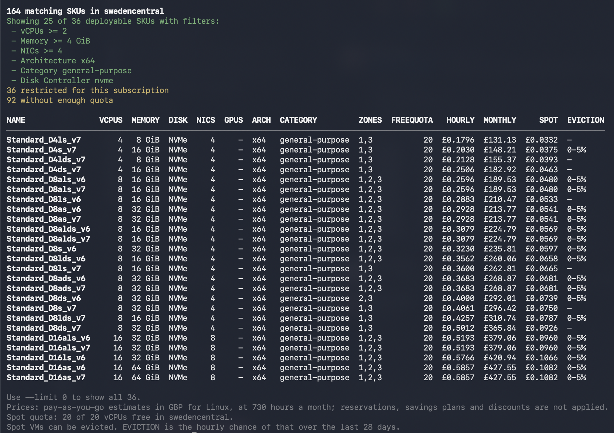

<!-- LOGO: docs/images/logo.png, about 120 px square. Remove this comment and uncomment the line below once it exists. -->
<!-- <p align="center"></p> -->

<h1 align="center">azskufinder</h1>

<p align="center">
  <strong>Find the Azure VM sizes you can actually deploy.</strong><br>
  Filtered by your requirements, your subscription's quota and Azure's restrictions, then priced.
</p>

<p align="center">
  <a href="https://github.com/mike-guy/azskufinder/releases/latest"></a>
  <a href="https://github.com/mike-guy/azskufinder/actions/workflows/security.yml"></a>
  <a href="https://scorecard.dev/viewer/?uri=github.com/mike-guy/azskufinder"></a>
  <a href="LICENSE"></a>
</p>
<p align="center"></p>

---

This small CLI app aims to take away some of the pain of trying to find an
available SKU that meets your needs, doesn't exceed your quotas and is not
restricted in the region/subscription that you are trying to deploy into.

Whilst all of this information is available via existing tools and the portal,
I found it a little disjointed and hard to get to, so this tool aims to make
life a little bit easier!

The app will takes your requirements, check them to see what your subscription
can actually deploy right now, and shows only the sizes that will work,
cheapest first (by default).

Currently only supports VM SKUs, but may be expanded in future.

```console
$ azskufinder vm -l uksouth --cpus 4 --memory 16
```

## Contents

- [Why azskufinder?](#why-azskufinder)
- [Features](#features)
- [Quick start](#quick-start)
- [Installation](#installation)
- [Signing in to Azure](#signing-in-to-azure)
- [Usage and examples](#usage-and-examples)
- [Reading the output](#reading-the-output)
- [Configuration](#configuration)
- [JSON output](#json-output)
- [Reference](#reference)
- [Troubleshooting and FAQ](#troubleshooting-and-faq)
- [Contributing, security and licence](#contributing-security-and-licence)

## Why azskufinder?

- **No more failed deployments.** SKUs that are restricted or unavailable for
  your subscription in a location are left out, and the zones restricted for
  each SKU are shown.
- **Quota-aware.** Each SKU is checked against the vCPU quota left for its
  family *and* for the region as a whole. Both have to fit.
- **Priced.** Every result has an estimated pay-as-you-go price per hour and per
  month from the Azure Retail Prices API, in pounds, dollars or euros, for
  Linux or Windows.
- **Spot-aware.** With `--include-spot` you also get Spot prices, eviction rates
  and SKUs that only your Spot quota allows.
- **Live.** Everything is read from Azure each time you run it, so quota and
  restrictions are always current. Nothing is cached or bundled.

## Features

- Filter by vCPUs, memory, GPUs, network interfaces, CPU architecture (x64 or
  Arm), VM category and disk controller (SCSI or NVMe), with numbers as minimums
  or exact values
- Live SKU restrictions, zone restrictions and family and regional vCPU quota
- Pay-as-you-go prices in GBP, USD or EUR, for Linux or Windows
- Spot prices, 28-day eviction rates and Spot-only results
- Constrained-core SKUs shown with the vCPUs you get and the vCPUs you're billed
  for
- Sort by any column, ascending or descending, and limit the results
- Readable, colour tables in a terminal; stable, versioned JSON for scripts
- Settings from flags, environment variables or a YAML config file
- Shell completion for bash, zsh, fish and PowerShell
- Results on standard output, progress and diagnostics on standard error, so it
  pipes cleanly
- Authenticated using existing Azure CLI tools - no credentials provided as flags

## Quick start

```sh
# 1. Install (see below for Windows and other options)
brew install mike-guy/tap/azskufinder

# 2. Sign in to Azure
az login

# 3. Find VM sizes with at least 2 vCPUs and 4 GiB of memory in UK South
azskufinder vm --subscription-id 00000000-0000-0000-0000-000000000000 \
  --location uksouth --cpus 2 --memory 4 --limit 4
```

```text
12 matching SKUs in uksouth
Showing 4 of 7 deployable SKUs with filters:
 - vCPUs >= 2
 - Memory >= 4 GiB
1 of them only as Spot (not enough on-demand quota)
2 restricted for this subscription
3 without enough quota

NAME                         VCPUS  MEMORY  DISK        NICS  GPUS  ARCH   CATEGORY         ZONES  FREEQUOTA   HOURLY  MONTHLY
──────────────────────────────────────────────────────────────────────────────────────────────────────────────────────────────
Standard_D4s_v5                  4  16 GiB  SCSI           2     -  x64    general-purpose  1,2,3         40  £0.1920  £140.16
Standard_E8-4s_v5     4 (8 billed)  64 GiB  SCSI, NVMe     4     -  x64    memory           -             24  £0.5040  £367.92
Standard_NC4as_T4_v3             4  28 GiB  NVMe           8     1  x64    gpu              2      Spot only  £0.5260  £383.98
Standard_D2pls_v5                2   4 GiB  -              -     -  arm64  general-purpose  -              0        -        -

Use --limit 0 to show all 7.
Prices: pay-as-you-go estimates in GBP for Linux, at 730 hours a month; reservations, savings plans and discounts are not applied.
```

The output above is illustrative. Your results depend on your subscription's
quota and restrictions.

> [!TIP]
> Set your subscription and location once, and leave them out from then on:
> `export AZSKUFINDER_SUBSCRIPTION_ID=00000000-0000-0000-0000-000000000000 AZSKUFINDER_LOCATION=uksouth`.
> See [Configuration](#configuration).

## Installation

### Homebrew (macOS and Linux)

```sh
brew install mike-guy/tap/azskufinder
```

Shell completions for bash, zsh and fish are installed with it.

### Scoop (Windows)

```powershell
scoop bucket add mike-guy https://github.com/mike-guy/scoop-bucket
scoop install mike-guy/azskufinder
```

### Go

With Go installed:

```sh
go install github.com/mike-guy/azskufinder/cmd/azskufinder@latest
```

### Download a release

Every [release](https://github.com/mike-guy/azskufinder/releases/latest) has
archives for Linux, macOS and Windows on x64 (`amd64`) and Arm (`arm64`). Each
holds the `azskufinder` binary, the licence, this README and shell completions.

<details>
<summary><strong>Commands for each platform</strong></summary>

Replace `0.1.0` with the latest version.

**macOS (Apple Silicon)**

```sh
curl -sSLO https://github.com/mike-guy/azskufinder/releases/download/v0.1.0/azskufinder_0.1.0_darwin_arm64.tar.gz
tar -xzf azskufinder_0.1.0_darwin_arm64.tar.gz azskufinder
sudo mv azskufinder /usr/local/bin/
```

The binaries aren't notarised by Apple. If macOS refuses to run a downloaded
binary, clear the quarantine flag with
`xattr -d com.apple.quarantine /usr/local/bin/azskufinder`. Homebrew does this
for you.

**macOS (Intel)**: as above, with `darwin_amd64`.

**Linux (x64)**

```sh
curl -sSLO https://github.com/mike-guy/azskufinder/releases/download/v0.1.0/azskufinder_0.1.0_linux_amd64.tar.gz
tar -xzf azskufinder_0.1.0_linux_amd64.tar.gz azskufinder
sudo install azskufinder /usr/local/bin/
```

**Linux (Arm)**: as above, with `linux_arm64`.

**Windows (PowerShell)**

```powershell
Invoke-WebRequest -Uri https://github.com/mike-guy/azskufinder/releases/download/v0.1.0/azskufinder_0.1.0_windows_amd64.zip -OutFile azskufinder.zip
Expand-Archive azskufinder.zip -DestinationPath "$env:LOCALAPPDATA\azskufinder"
# Then add $env:LOCALAPPDATA\azskufinder to your PATH.
```

</details>

### Verifying a download

Every archive is built by GitHub Actions and has a signed build provenance
attestation, which proves which repository, workflow and commit produced it.
Check it with the [GitHub CLI](https://cli.github.com/):

```sh
gh attestation verify azskufinder_0.1.0_linux_amd64.tar.gz --repo mike-guy/azskufinder
```

The attestation is attached to the release too (`azskufinder_<version>.sigstore.json`),
so you can check a download without asking GitHub for it:

```sh
gh attestation verify azskufinder_0.1.0_linux_amd64.tar.gz \
  --bundle azskufinder_0.1.0.sigstore.json --repo mike-guy/azskufinder
```

Or check the archive against the release's `checksums.txt`:

```sh
sha256sum --check --ignore-missing checksums.txt
```

An SPDX software bill of materials (`*.sbom.json`) for each binary is attached
to every release too. See [SECURITY.md](SECURITY.md) for more.

### Shell completion

Homebrew sets this up for you. Otherwise, generate the script for your shell:

```sh
# bash: add to ~/.bashrc
source <(azskufinder completion bash)

# zsh: add to ~/.zshrc
source <(azskufinder completion zsh)

# fish
azskufinder completion fish > ~/.config/fish/completions/azskufinder.fish
```

```powershell
# PowerShell: add to your $PROFILE
azskufinder completion powershell | Out-String | Invoke-Expression
```

Completion covers commands, flags and the fixed values of `--arch`,
`--category`, `--disk-controller`, `--currency`, `--os` and `--sort-by`.

## Signing in to Azure

azskufinder signs in the same way as the Azure SDKs. It tries each of these in
turn and uses the first that works:

1. **A service principal** in the `AZURE_TENANT_ID`, `AZURE_CLIENT_ID` and
   `AZURE_CLIENT_SECRET` environment variables
2. **Workload identity**, for example in Kubernetes or GitHub Actions
3. **Managed identity**, on an Azure VM, App Service, Container Apps and so on
4. **The Azure CLI** (`az login`)
5. **The Azure Developer CLI** (`azd auth login`)
6. **Azure PowerShell** (`Connect-AzAccount`)

On your own machine, `az login` is all you need.

The identity needs the **Reader** role on the subscription. Reader covers
everything azskufinder reads, including Spot eviction rates:

```sh
az role assignment create --assignee <user-or-principal-id> \
  --role Reader --scope /subscriptions/00000000-0000-0000-0000-000000000000
```

> [!IMPORTANT]
> azskufinder never takes a credential as a flag, so secrets can't end up in
> your shell history or in a process listing. It only reads from Azure and never
> changes anything in your subscription.

## Usage and examples

```text
azskufinder vm [flags]
```

`vm` finds virtual machine SKUs. A subscription ID and a location are always
required, because quota and restrictions are specific to both. Every other
requirement is optional: anything you leave out is not filtered on. The examples
below assume you've set `AZSKUFINDER_SUBSCRIPTION_ID` (see
[Configuration](#configuration)); otherwise add
`--subscription-id <id>` to each.

### Find by size

At least 4 vCPUs and 16 GiB of memory in UK South:

```sh
azskufinder vm -l uksouth --cpus 4 --memory 16
```

Exactly 8 vCPUs, rather than at least 8. `--exact-match` applies to `--cpus`,
`--memory`, `--gpus` and `--nics` together:

```sh
azskufinder vm -l uksouth --cpus 8 --exact-match
```

Sizes that can take at least 3 network interfaces (NICs). Azure caps the number
each size can take, and small sizes often allow only 2:

```sh
azskufinder vm -l uksouth --cpus 4 --nics 3
```

### Find by kind of VM

Memory-optimised VMs on Arm, in Sweden Central:

```sh
azskufinder vm -l swedencentral --category memory --arch arm64
```

Compute-optimised or HPC VMs with at least 16 vCPUs. Separate several
categories with commas:

```sh
azskufinder vm -l westeurope --category compute,hpc --cpus 16
```

> [!NOTE]
> Azure doesn't publish a category for each SKU, so azskufinder works it out
> from the SKU's name: the `D` in `Standard_D4s_v5` means general purpose, the
> `E` memory optimised, and so on. See [Categories](#categories).

### Disk controllers

Some images need a particular disk controller. Many newer sizes, such as most
v6 SKUs, support only NVMe, so an image without NVMe drivers won't boot on them,
and an image that needs NVMe can't be used on a size that supports only SCSI.
Ask for the controller your image needs:

```sh
azskufinder vm -l uksouth --cpus 4 --disk-controller nvme
```

`nvme` keeps sizes that support NVMe, including those that support both, and
`scsi` keeps sizes that support SCSI. Older sizes don't report a controller;
Azure documents that they use SCSI, so they're treated as SCSI only. The `DISK`
column shows each size's controllers.

### GPUs

VMs with at least one GPU:

```sh
azskufinder vm -l eastus --gpus 1
```

VMs with no GPUs at all:

```sh
azskufinder vm -l eastus --cpus 4 --gpus 0 --exact-match
```

### Prices

Prices are estimates for Linux in pounds sterling unless you say otherwise.
Windows prices in US dollars:

```sh
azskufinder vm -l eastus --cpus 4 --os windows --currency USD
```

### Spot VMs

Add Spot prices and eviction rates. This also keeps SKUs that don't have enough
on-demand quota but fit your Spot quota, marked `Spot only`:

```sh
azskufinder vm -l uksouth --cpus 4 --include-spot
```

<details>
<summary>Sample output as text</summary>

```text
12 matching SKUs in uksouth
Showing 4 of 7 deployable SKUs with filters:
 - vCPUs >= 2
 - Memory >= 4 GiB
1 of them only as Spot (not enough on-demand quota)
2 restricted for this subscription
3 without enough quota

NAME                         VCPUS  MEMORY  DISK        NICS  GPUS  ARCH   CATEGORY         ZONES  FREEQUOTA   HOURLY  MONTHLY     SPOT  EVICTION
─────────────────────────────────────────────────────────────────────────────────────────────────────────────────────────────────────────────────
Standard_D4s_v5                  4  16 GiB  SCSI           2     -  x64    general-purpose  1,2,3         40  $0.1920  $140.16  $0.0384  0-5%
Standard_E8-4s_v5     4 (8 billed)  64 GiB  SCSI, NVMe     4     -  x64    memory           -             24  $0.5040  $367.92  $0.1008  -
Standard_NC4as_T4_v3             4  28 GiB  NVMe           8     1  x64    gpu              2      Spot only  $0.5260  $383.98  $0.1052  5-10%
Standard_D2pls_v5                2   4 GiB  -              -     -  arm64  general-purpose  -              0        -        -        -  n/a

Use --limit 0 to show all 7.
Prices: pay-as-you-go estimates in USD for Linux, at 730 hours a month; reservations, savings plans and discounts are not applied.
Spot quota: 96 of 100 vCPUs free in uksouth.
Spot VMs can be evicted. EVICTION is the hourly chance of that over the last 28 days.
```

</details>

The Spot VMs least likely to be evicted first:

```sh
azskufinder vm -l uksouth --cpus 4 --include-spot --sort-by eviction
```

### Sorting and limiting

Results are sorted by monthly price, cheapest first, and the first 25 are
shown. Sort by any column, adding `:desc` for descending order:

```sh
azskufinder vm -l uksouth --cpus 4 --sort-by memory:desc
```

Sorting happens before the limit, so this shows the five SKUs with the most
memory:

```sh
azskufinder vm -l uksouth --cpus 4 --sort-by memory:desc --limit 5
```

Show every result:

```sh
azskufinder vm -l uksouth --cpus 4 --limit 0
```

### Scripting with JSON

`-o json` writes the results as JSON on standard output. Progress and warnings
go to standard error, so the output pipes straight into tools such as
[jq](https://jqlang.org/):

The cheapest deployable SKU:

```sh
azskufinder vm -l uksouth --cpus 4 --memory 16 -o json | jq -r '.results[0].name'
```

Names, vCPUs, memory and monthly price as CSV:

```sh
azskufinder vm -l uksouth --cpus 4 --limit 0 -o json \
  | jq -r '.results[] | [.name, .vcpusAvailable, .memoryGiB, .pricing.onDemandMonthly] | @csv'
```

Only SKUs available in all three availability zones:

```sh
azskufinder vm -l uksouth --cpus 4 --limit 0 -o json \
  | jq -r '.results[] | select(.zones | length == 3) | .name'
```

### Using environment variables

Every flag can be set by an environment variable, which is handy in scripts and
CI:

```sh
export AZSKUFINDER_SUBSCRIPTION_ID=00000000-0000-0000-0000-000000000000
export AZSKUFINDER_LOCATION=uksouth
export AZSKUFINDER_CURRENCY=EUR

azskufinder vm --cpus 4 --memory 16
```

### Troubleshooting a run

`--debug` writes debug logs to standard error, including the Azure SDK's
request, response and retry logs and the reason each SKU was left out. `--timeout` sets how long to wait in total (2 minutes by default):

```sh
azskufinder vm -l uksouth --cpus 4 --debug --timeout 30s 2> debug.log
```

## Reading the output

```text
12 matching SKUs in uksouth                                        ← SKUs that meet your requirements
Showing 4 of 7 deployable SKUs with filters:                      ← how many are shown
 - vCPUs >= 2                                                     ← the filters, one to a line
 - Memory >= 4 GiB
1 of them only as Spot (not enough on-demand quota)               ← with --include-spot
2 restricted for this subscription                                ← left out: restricted by Azure
3 without enough quota                                            ← left out: not enough vCPU quota

NAME                         VCPUS  MEMORY  DISK        NICS  GPUS  ARCH   CATEGORY         ZONES  FREEQUOTA   HOURLY  MONTHLY
Standard_D4s_v5                  4  16 GiB  SCSI           2     -  x64    general-purpose  1,2,3         40  £0.1920  £140.16
Standard_E8-4s_v5     4 (8 billed)  64 GiB  SCSI, NVMe     4     -  x64    memory           -             24  £0.5040  £367.92
```

| Column | Meaning |
|---|---|
| `NAME` | The SKU name to deploy with |
| `VCPUS` | vCPUs the VM gets. For [constrained-core](https://learn.microsoft.com/azure/virtual-machines/constrained-vcpu) SKUs, such as `Standard_E8-4s_v5`, the vCPUs you're billed for, and that count against quota, are shown in brackets |
| `MEMORY` | Memory in GiB |
| `DISK` | Disk controllers the SKU supports: `SCSI`, `NVMe` or `SCSI, NVMe`. `-` if Azure reports only controllers azskufinder doesn't know |
| `NICS` | The most network interfaces the SKU can take; `-` if Azure didn't say |
| `GPUS` | Number of GPUs, `-` for none |
| `ARCH` | `x64` or `arm64` |
| `CATEGORY` | The kind of VM, worked out from the name (see [Categories](#categories)) |
| `ZONES` | Availability zones you can deploy to; `-` if the SKU isn't zonal there, or every zone is restricted |
| `FREEQUOTA` | vCPUs of quota left: the lower of the SKU family's quota and the region's. `Spot only` means only Spot quota fits |
| `HOURLY`, `MONTHLY` | Estimated pay-as-you-go price. Monthly is hourly × 730 hours. `-` if Azure has no retail price, which a note under the table counts |
| `SPOT` | Spot price per hour (with `--include-spot`) |
| `EVICTION` | The hourly chance, over the last 28 days, that Azure evicts a Spot VM of this size (with `--include-spot`). `n/a` means the SKU can't run as Spot; `-` that Azure has no rate for it |

> [!NOTE]
> Prices are pay-as-you-go estimates from the public
> [Azure Retail Prices API](https://learn.microsoft.com/rest/api/cost-management/retail-prices/azure-retail-prices).
> Reservations, savings plans, enterprise agreements and other discounts are
> not applied, so your invoice may be lower.

## Configuration

Settings come from these places, highest precedence first:

1. Flags
2. Environment variables
3. The YAML config file
4. Default values

### Environment variables

Each flag has an environment variable: its name in upper case, with hyphens
replaced by underscores and prefixed with `AZSKUFINDER_`.

| Flag | Environment variable |
|---|---|
| `--subscription-id` | `AZSKUFINDER_SUBSCRIPTION_ID` |
| `--location` | `AZSKUFINDER_LOCATION` |
| `--include-spot` | `AZSKUFINDER_INCLUDE_SPOT` |
| `--no-colour` | `AZSKUFINDER_NO_COLOUR` |

`azskufinder vm --help` lists the variable for every flag.

### Config file

azskufinder reads `config.yaml` from a `.azskufinder` directory in your home
directory, or the file named by `--config`:

| OS | Default location |
|---|---|
| macOS | `~/.azskufinder/config.yaml` (`/Users/<you>/.azskufinder/config.yaml`) |
| Linux | `~/.azskufinder/config.yaml` (`/home/<you>/.azskufinder/config.yaml`) |
| Windows | `%USERPROFILE%\.azskufinder\config.yaml` (`C:\Users\<you>\.azskufinder\config.yaml`) |

The keys are the flag names:

```yaml
subscription-id: 00000000-0000-0000-0000-000000000000
location: uksouth
currency: GBP
os: linux
include-spot: true
limit: 10
```

The default config file is optional: if it doesn't exist, azskufinder carries
on without it. A file named with `--config` must exist. A config file that
can't be read or parsed is a usage error (exit code `2`).

## JSON output

`-o json` produces a single JSON document. `apiVersion` identifies its shape:
within a version, fields are only ever added, never renamed or removed, so
scripts written against `azskufinder/v1` keep working.

<details>
<summary><strong>Sample JSON output</strong> (one result shown)</summary>

```json
{
  "apiVersion": "azskufinder/v1",
  "kind": "vm",
  "criteria": [
    { "name": "vCPUs", "value": ">= 2" },
    { "name": "category", "value": "general-purpose or memory" }
  ],
  "pricing": { "currency": "GBP", "os": "linux", "hoursPerMonth": 730 },
  "location": "uksouth",
  "summary": {
    "considered": 900,
    "matched": 12,
    "restricted": 2,
    "noQuota": 3,
    "eligible": 7,
    "spotOnly": 1,
    "shown": 4
  },
  "spotQuota": { "name": "lowPriorityCores", "limit": 100, "used": 4, "free": 96 },
  "results": [
    {
      "name": "Standard_D4s_v5",
      "family": "standardDSv5Family",
      "vcpus": 4,
      "vcpusAvailable": 4,
      "memoryGiB": 16,
      "gpus": 0,
      "maxNetworkInterfaces": 2,
      "architecture": "x64",
      "category": "general-purpose",
      "zones": ["1", "2", "3"],
      "diskControllers": ["scsi"],
      "spotCapable": true,
      "spotOnly": false,
      "quota": [
        { "name": "standardDSv5Family", "limit": 100, "used": 20, "free": 80 },
        { "name": "cores", "limit": 50, "used": 10, "free": 40 }
      ],
      "pricing": { "onDemandHourly": 0.192, "onDemandMonthly": 140.16 },
      "spot": { "hourlyPrice": 0.0384, "evictionRate": "0-5" }
    }
  ]
}
```

`vcpus` is the number of vCPUs billed and counted against quota;
`vcpusAvailable` is the number the VM gets. They differ only for
constrained-core SKUs. `diskControllers` lists `scsi`, `nvme` or both, and is
`[]` if Azure reports only controllers azskufinder doesn't know. A price with no
retail value is `null`, and so is a `maxNetworkInterfaces` or `evictionRate`
Azure didn't report.

</details>

## Colour and accessibility

Tables use colour and bold text in a terminal. Colour is turned off
automatically when the output is piped or redirected, and you can turn it off
yourself by setting [`NO_COLOR`](https://no-color.org/) or passing
`--no-colour`. Standard output and standard error are decided separately, so
redirecting one doesn't change the other.

## Reference

### Global flags

| Flag | Short | Default | Description |
|---|---|---|---|
| `--subscription-id` | `-s` | | Azure subscription ID (required) |
| `--location` | `-l` | | Azure location, for example `uksouth` (required) |
| `--output` | `-o` | `table` | Output format: `table` or `json` |
| `--currency` | | `GBP` | Currency for prices: `GBP`, `USD` or `EUR` |
| `--limit` | `-n` | `25` | Maximum number of SKUs to show; `0` for all |
| `--timeout` | | `2m` | Give up after this long; `0` for no limit |
| `--config` | | see [Config file](#config-file) | Path to a YAML config file |
| `--no-colour` | | | Don't colour or style the output |
| `--debug` | | | Log requests and responses to standard error |
| `--version` | `-v` | | Print the version |

### `vm` flags

| Flag | Short | Default | Description |
|---|---|---|---|
| `--cpus` | `-c` | | Number of vCPUs: a minimum, or exact with `--exact-match` |
| `--memory` | `-m` | | Memory in GiB: a minimum, or exact with `--exact-match` |
| `--gpus` | `-g` | | Number of GPUs: a minimum, or exact with `--exact-match` |
| `--nics` | | | Network interfaces the VM must take: a minimum, or exact with `--exact-match` |
| `--exact-match` | `-e` | | Make `--cpus`, `--memory`, `--gpus` and `--nics` exact values |
| `--arch` | `-a` | `any` | CPU architecture: `any`, `x64` or `arm64` |
| `--category` | `-C` | | Kinds of VM, comma separated (see below) |
| `--disk-controller` | | `any` | Disk controller the VM must support: `any`, `scsi` or `nvme` |
| `--os` | | `linux` | Operating system to price: `linux` or `windows` |
| `--include-spot` | `-S` | | Add Spot prices and eviction rates, and keep Spot-only SKUs |
| `--sort-by` | | `monthly` | Column to sort by, with `:desc` for descending (see below) |

### Categories

The category comes from the series letter at the start of the SKU name.

| Value | Series | Example |
|---|---|---|
| `general-purpose` | A, B, D | `Standard_D4s_v5` |
| `burstable` | B (also counted as general purpose) | `Standard_B2ms` |
| `compute` | F | `Standard_F8s_v2` |
| `memory` | E, G, M | `Standard_E8s_v5` |
| `storage` | L | `Standard_L8s_v3` |
| `gpu` | N, and any SKU with GPUs | `Standard_NC4as_T4_v3` |
| `hpc` | H | `Standard_HB120rs_v3` |

Any other series, such as the FPGA `PB` series, is shown as `other`, and is
matched only when no `--category` is given.

### Sort columns

`name`, `vcpus`, `memory`, `nics`, `gpus`, `arch`, `category`, `freequota`,
`hourly`, `monthly`, `spot` and `eviction`. Add `:desc` to sort in descending order. SKUs
with no value for the column always come last, and so do `Spot only` SKUs when
sorting by `freequota`. `spot` and `eviction` need `--include-spot`.

### Exit codes

| Code | Meaning |
|---|---|
| `0` | Success, including when no SKUs match |
| `1` | Something went wrong at run time, such as an Azure error or a timeout |
| `2` | Usage error: a missing or invalid flag, or a config file that can't be read |
| `130` | Interrupted with Ctrl+C |

## Troubleshooting and FAQ

**No SKUs are shown.**
The summary lines say why: how many matched your requirements, and how many of
those were restricted or didn't have enough quota. Try relaxing the
requirements, a different location, or `--include-spot`. If most results lack
quota, you can
[request a quota increase](https://learn.microsoft.com/azure/quotas/per-vm-quota-requests).

**A SKU I can see in the portal is missing.**
It's either restricted for your subscription in that location, or your remaining
family or regional vCPU quota is too small for it. Both are counted in the
summary. `--debug` shows the reason for each SKU.

**The prices don't match my invoice.**
They're public pay-as-you-go retail prices for the VM itself. Reservations,
savings plans and negotiated discounts aren't applied, and disks, networking and
other resources aren't included.

**It says I'm not signed in, or I don't have access.**
Run `az login` (or see [Signing in to Azure](#signing-in-to-azure)), and check
the identity has the Reader role on the subscription you passed.

**I'm being throttled by Azure.**
azskufinder retries throttled requests automatically (three times, with
backoff, honouring Azure's `Retry-After`). If it keeps happening, wait a minute
before running it again.

## Contributing, security and licence

- **Contributing:** issues and pull requests are welcome. See
  [CONTRIBUTING.md](CONTRIBUTING.md) to get set up.
- **Security:** please report vulnerabilities privately. See
  [SECURITY.md](SECURITY.md).
- **Licence:** [MIT](LICENSE).
